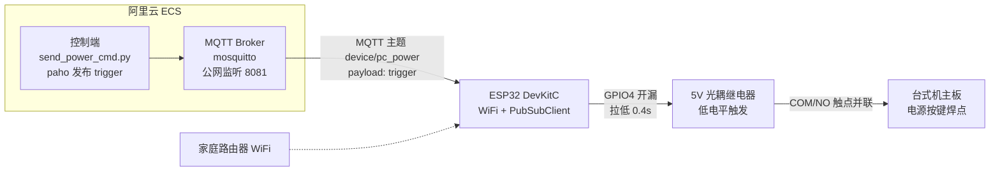

# ESP32 远程开机控制器

台式机完全关机后，通过阿里云 ECS 下发 MQTT 指令，远程触发电源按键开机。
ESP32 + 光耦隔离继电器并联主板电源键，模拟人手短接电源按钮；保留机箱原生电源键功能。

## 架构图



## 工作原理

1. 电脑关机后本机程序/FRP 客户端无法运行 → ESP32 独立供电，保持 WiFi + MQTT 长连接
2. 人在外面 ssh 进 ECS，跑 `send_power_cmd.py` 向 MQTT 主题 `device/pc_power` 发布 `trigger`
3. ESP32 收到合法指令 → GPIO4 拉低 0.4s → 继电器吸合 → COM/NO 触点短接主板电源键 → 开机
4. **10s 冷却防误触**：冷却期内重复指令直接丢弃（网络抖动不会长按电源键导致强制关机）
5. **光耦隔离**：ESP32 与主板电气隔离，两边不共地，保护主板

### 关键设计点

- **开漏驱动（v7 实测坑）**：3.3V 单片机驱动 5V 低电平触发模块——推挽输出 HIGH(3.3V) 在 5V 供电下仍算低电平，继电器无法断开。改用 GPIO4 开漏模式：HIGH=高阻悬空(断开)、LOW=0V(吸合)
- **GPIO4 选择**：避开 strapping 引脚 GPIO2（上电采样干扰）
- **上电安全态**：固件默认 GPIO4 HIGH → 继电器断开，上电不会误触发开机
- **继电器 NC 不用**：常闭脚默认导通，用了逻辑反且上电即触发

## 组件结构

```
esp32-remote-power/
├── PC_PowerRelay/            # ESP32 固件（Arduino IDE）
│   ├── PC_PowerRelay.ino     # 主固件 v7（开漏驱动、冷却、自动重连）
│   └── 接线说明.md            # 接线 + 分阶段测试步骤（含真实主板接法）
├── server/                   # 服务端（阿里云 ECS 部署物）
│   ├── install_mosquitto.sh  # MQTT Broker 一键部署 + 自测
│   ├── send_power_cmd.py     # 控制脚本（paho，带触发日志）
│   └── send_power_cmd.sh     # 备用（mosquitto_pub 版）
└── simulator/                # 模拟器（无硬件验证 MQTT 全链路）
    ├── simulator.py
    └── README.md
```

## 硬件清单

| 序号 | 名称 | 数量 | 说明 |
|---|---|---|---|
| 1 | ESP32 DevKitC | 1 | 主控 |
| 2 | 5V 光耦隔离继电器模块 | 1 | 低电平触发，NO/COM 触点模拟按键 |
| 3 | 杜邦线 | 若干 | 母对母 |
| 4 | 独立 5V 手机充电器（推荐） | 1 | 给 ESP32 供电，避免吃主板 S5 待机电流 |

### 接线（信号侧）

| 继电器引脚 | → ESP32 引脚 |
|---|---|
| VCC | 5V（板载输出） |
| GND | GND |
| IN（信号脚） | GPIO4 |

负载侧：继电器 COM/NO 两根线**并联**焊接到主板电源按键背面焊点（无极性，不分正反）。
❌ 禁止用 NC 脚；❌ 触点只接无源按键引脚，不接任何强电。

详细接线与分阶段测试见 [PC_PowerRelay/接线说明.md](PC_PowerRelay/接线说明.md)。

## 快速部署

### 1. 服务端（ECS）

```bash
sudo bash install_mosquitto.sh          # 部署 MQTT Broker + 自测
# 安全组放行 TCP 8081（来源限定自己的 IP，别 0.0.0.0/0 裸奔）
sudo bash -c 'echo -e "\nlistener 8081 0.0.0.0" >> /etc/mosquitto/mosquitto.conf'
sudo systemctl restart mosquitto
```

### 2. 固件烧录（Arduino IDE）

- 打开 `PC_PowerRelay/PC_PowerRelay.ino`，选板 ESP32 Dev Module
- 修改配置项（烧录前必改）：`ssid` / `password` / `mqttServer`（=ECS 公网 IP）/ `mqttPort`（8081）
- 依赖：WiFi（内置）、PubSubClient（库管理器安装）

### 3. 使用

```bash
# ECS 上执行（带触发日志）
python3 send_power_cmd.py
# 日志：/var/log/pc_power_control.log
```

## 验证记录（真实环境）

- **2026-09-15 真实主板验证通过 ✅**：继电器 COM/NO 接主板电源键焊点（PB-EPWR），ECS 执行命令实测开机成功
- **公网全链路验证 ✅**：模拟器连 `<ECS公网IP>:8081`，发布 → Broker → 订阅 → 动作全通
- **冷却验证 ✅**：2s 内连发两次，第二次被丢弃（`[IGNORE] 冷却中`）
- **LED 测试版验证 ✅**：继电器驱动 LED 模拟电源键，上电不误触发 / trigger 吸合 0.4s / 冷却生效
- 分阶段测试：离线硬件 → 主板静态接线 → 整机本地 → 外网全链路（详见接线说明.md）

## 安全注意事项

1. 焊接主板前**必须拔掉台式机电源线**，释放残余电压
2. 继电器触点只接主板电源按键无源引脚，不接入 220V 强电
3. 焊接前先脱离主板单独测试继电器动作
4. ESP32 优先独立电源供电（主板 S5 待机 USB 电流小，会反复重启）
5. MQTT Broker 安全组来源限定，别裸奔公网

## 扩展预留

- [ ] ESP32 上报 PC 开关机状态（主板 5V 待机信号检测）
- [ ] Web 管理页面
- [ ] 指令鉴权（非法 payload 拒绝执行）

## 来源

- 需求文档 V1.0（原 远程控制开机.txt，内容已并入本 README 与接线说明.md）
- 固件 v7（2026-09-15 定稿，真实主板验证）
